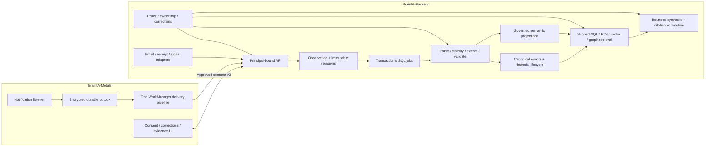

# Brain AI v2 architecture

Plan version: 2.0.0-draft.1 · 2026-10-15 · Status: proposed, not approved for implementation.

## Scope and evidence limits

Master planning repository: **BrainIA-Backend**, inspected at `D:/Coding/BrainIA/BrainIA-Backend`, HEAD `e0ccc565ebd3c956fd138b5d5300010e8579245c`. Mobile was accessible at the explicit path `D:/Coding/BrainIA/BrainIA-Mobile` and inspected read-only, HEAD `a526b3498fff63df5374c72c11ab09ccc39d13fc`. Both checkouts contain substantial existing uncommitted work; these HEADs do not describe their entire inspected state. Phase 0 must preserve and fingerprint that state before worker worktrees are prepared. Do not overwrite or discard it. `BrainIA-Backend/mobile` is a legacy directory, not the independent mobile repository.

Graphify query was used in both repositories before source navigation; no wiki index was present. Source code takes precedence over graph summaries. This is a static inspection, not a deployed database/APK audit. No database connection, migration, application test, provider request containing personal data, worker startup, or deployment was performed. The supplied architectural findings are treated as audit hypotheses. No standalone end-to-end audit file was located; `docs/architecture.md`, `docs/brainia-next.md`, existing tests, mobile `docs/backend-contract.md`, and `docs/ux-rebuild-implementation-audit.md` provide additional context. The mobile UX audit is not evidence of native capture reliability.

## Current implementation and validated findings

| ID | Finding and source evidence | Disposition |
|---|---|---|
| F01 | `src/storage/event-repository.ts:263` cleanup deletes semantic data, facts, financial evidence and orphan financial transactions; `event-store.ts:442` invokes it during semantic reprocessing. `job-worker.ts:56` requests `reuseClassification:true, skipFinancial:true`. | Confirmed destructive code path; runtime regression required. Split projection ownership immediately. |
| F02 | Cleanup removes `classified_events`; canonical transaction IDs and transaction-level edits can disappear on rebuild. Existing `correction-memory.ts`, `correction-projection.ts`, `classification-learning.ts` already support corrections. | Preserve and extend correction overlay; do not build a competing learning subsystem. Exact affected correction fields require fixtures. |
| F03 | `job-repository.ts` claims queued/retry only with SKIP LOCKED, stores locked_at/by, completes/fails by ID without attempt fencing. Inline settlement also changes state independently. | Confirmed absent running-job reclaim and stale-attempt guard in this repository. |
| F04 | `auth.ts` permits disabled auth and global-key mode with caller-supplied client header; auth hook does not attach a validated principal. `routes/privacy.ts` updates entity visibility without owner argument; financial repository methods accept IDs without principal. | Authentication exists; uniform authorization does not. Route-by-route exploit tests required. |
| F05 | `hybrid-retrieval.ts` entity/relation/insight/digest SQL branches and graph expansion lack the event branch's scope filters; vector branch includes null-client records, ignores several filters, searches newest 1,000. | Confirmed query risks, not proof of a live exfiltration incident. |
| F06 | `embeddings.ts` uses 192-d hash vectors, optional remote provider, same embedding_version across fallback/model spaces; generates before checking content hash and has no source policy check. | Isolate spaces and enforce provider eligibility; retain hash baseline. |
| F07 | `financial-transactions.ts` treats bare dollars/bare numbers as local UYU in some paths, parses JS Number and rounds to two decimals; candidate matching admits UNKNOWN currency as wildcard in `financial-transaction-repository.ts:883`. | Preserve uncertain evidence, block confirmed totals and automatic matching. Current normalizeCurrency only uppercases; supplied claim of arbitrary currency conversion is not confirmed there. |
| F08 | Evidence count uses both stored count and lateral count in different reads; cleanup/relink and consolidation paths coexist. | Inflation is a regression hypothesis, not established from count increment alone. Require distinct-observation/revision tests and remove inconsistent cached semantics. |
| F09 | `migrate.ts` trusts filename ledger. `pending-financial-schema.ts` checks one table then writes migration ledger; `intelligence-schema.ts` has table sentinel and runtime DDL. `0037` enables RLS, `0038` revokes helper execution conditionally. | Partial-schema drift is possible. Installed grants/policies/triggers/views/roles are unknown. Do not equate migration presence with protection. |
| F10 | DeepSeek wrapper timer clears after fetch headers, before response body parsing (`deepseek.ts:83`); semantic lock spans global read/model/write (`postgres.ts`). | Full response deadline and short scoped write locks required. |
| F11 | Mobile `NotificationBridgeService.kt` sends directly, replays active notifications, uses key-only idempotency; 2xx accepted without durable revision acknowledgement. No persistent capture queue found in inspected service. | Updates/dismissed offline evidence can be lost. Device validation outstanding. |
| F12 | Mobile `shouldCapture` falls back to finance-app defaults when selected set is empty; native module stores API key in SharedPreferences although JS storage uses SecureStore. | Confirmed consent ambiguity and native credential duplication. |
| F13 | Mobile `android/app/release.keystore` exists; build.gradle loads release configuration. | Exposure/distribution/signing provenance unverified. Do not read/export key material or assume compromise. Security owner must inspect tracked history and Play signing relationships privately. |
| F14 | Mobile UX audit describes fixed UYU/USD conversion reference; `lib/financial-summary.ts` exists. | Validate display calculations before release; remove fixed implicit conversions, require dated explicit rate. |

## Reuse and target boundaries

Retain Node ESM/Fastify/Zod, parameterized SQL, raw_events, capture v1, classified_events, financial tables, graph entities/aliases/merges, semantic decisions, correction memory, background_jobs, FTS, intelligence revisions, deterministic detectors and citation validation/repair. Keep standalone and serverless adapters. No microservices, graph database, general external-action agent, new queue service, or mandatory pgvector deployment is required.

Modules are boundaries within the existing backend process. Capture commits evidence and jobs atomically before acknowledgement; expensive work runs outside request and database transactions. A serverless request must never depend on post-response in-memory execution. Cron can overlap safely through leases. Standalone workers use the identical database contract. Phase 0 verifies the deployed Vercel plan, duration and cron entitlements; do not infer them from `vercel.json`.

## Identity and projection ownership

Delivery attempt != observation != immutable revision != fact != canonical event != projection. An observation can support several events/facts; several observations can support one event. A revision supersedes content, never silently creates a new purchase. Repeated identical purchases remain separate unless strong identity evidence proves sameness.

| Owned projection | Sole writer / replacement scope | Preservation rule |
|---|---|---|
| Raw observations/revisions/delivery receipts | capture | append only except explicit retention/deletion |
| Classification decisions + extracted facts | extraction | revision + extractor version; preserve competing facts |
| Active correction overlay and rules | user correction service | automated workers cannot delete or override |
| Financial evidence and canonical transaction | finance reconciler | upsert stable IDs; semantic tasks have no delete authority |
| Semantic anchors/candidates/decisions | semantic materializer | owner + revision + generation only |
| Personal entities, aliases, relations | scoped governance | retire unsupported edges; preserve corrections and other evidence |
| Shared taxonomy | controlled taxonomy migration | public definitions only; never personal descriptors/counts |
| Embeddings/search indexes | indexing | space + content + policy version; disposable, traceable |
| Episodes and summaries | temporal service | revisioned memberships; no causal claim from similarity |
| Intelligence artifacts | existing intelligence pipeline | revisions and dependency invalidation; validate citations |

Every replaceable row gains producer/domain and generation lineage where absent. Stage writes validate current revision, correction version, policy version and job fence, then publish a generation atomically. Never globally sweep orphan financial transactions as a side effect of unrelated reprocessing. Use targeted retirement and explicit separately verified garbage collection.

## Security and privacy

Principal is server-resolved `{principalId, ownerId, deviceId?, scopes, authVersion}`. Start with registered per-device secrets mapped to an owner, hashed server-side and revocable; preserve client-key compatibility through this registry. An ID header is a compatibility hint, never authority. Reject mismatch. Disable anonymous/global-key personal-data access in deployed environments; isolate explicit administration credentials and exact cron routes. OAuth user identity can later bind to the same owner mapping without changing evidence ownership.

All personal tables and query methods require owner; legacy null-client data is quarantined until a human-reviewed mapping assigns it. Existing globally deduplicated personal entities are split by owner with scoped aliases/edges; keep public taxonomy separate. Do not infer ownership from a global entity ID. Joins, exports, graph traversal, aggregates, correction memory, caches and workers carry the same owner context. Inaccessible IDs return 404; invalid credentials 401; valid identity without operation scope 403.

Use a restricted non-owner, non-BYPASSRLS runtime DB role and transaction-local owner context; RLS uses that context for defense in depth. Dedicated maintenance role only in controlled jobs. Verify pool context resets at transaction end and mixed-owner reuse cannot leak. Revoke unnecessary anon/authenticated table, sequence and function privileges and default privileges; RLS on exposed tables; inspect security-definer functions and views. Direct DB access does not magically apply Supabase JWT ownership. See [Supabase RLS](https://supabase.com/docs/guides/database/postgres/row-level-security).

One provider authorization boundary handles classification, semantic context, graph proposals, embeddings, intelligence planning/drafting/repair/verification, insights/digests and inspect summaries. It resolves all supporting source policies immediately before dispatch and after waiting for concurrency tokens. Effective permission is intersection of evidence policies. Private evidence may be queried locally by its owner but cannot enter external prompts/embeddings; hidden evidence is excluded from normal retrieval. Source disabled stops new capture/processing and retrieval for that source; existing storage remains until explicit deletion/retention. `sendToLlm:false` also denies external embeddings. Revocation increments policy version, cancels pending work, invalidates caches/indexes/summaries and blocks stale publication. An already dispatched request cannot be recalled: surface that fact and retain metadata-only dispatch audit.

New source registration defaults to disabled capture and denied external models/embeddings until explicit owner consent. Legacy missing-policy rows do not inherit today's permissive default automatically: migration records an approved policy decision or quarantines provider processing. B06 closes ownership/source visibility leaks in every existing retrieval branch during Phase1; B21 later improves ranking, recall and index performance. Privacy correctness cannot wait for the semantic retrieval phase.

Local capture empty selection means capture none; first-run suggestions require affirmative confirmation. Native credentials use Android Keystore-backed encryption, excluded from backup; no shared plaintext preference copy. Account logout removes credentials and pauses that account's queue. No release credentials, personal payloads or provider response bodies in diagnostic logs/reports.

Deletion tombstones block replay first, then remove raw content, facts, correction-derived content, embeddings (including stored text), graph evidence, financial links, caches, episodes, artifacts and connector copies. Recompute shared-within-owner objects from remaining permitted evidence or retire them. Do not destroy other observations supporting a financial event. User-requested evidence deletion cannot leave a factual conclusion pretending its source still exists. Backup retention and restore tombstone replay are explicit in the data model and PRD.

## Financial and temporal decisions

Use exact decimal strings and PostgreSQL NUMERIC. Known-but-not-reportable currency stays as observed; UNKNOWN remains unknown. UYU/USD initially reportable only, with no conversion default. Dated rates are optional explicit conversions. Amount roles distinguish purchase/total/tax/balance/installment/refund/fee. Real-world lifecycle is independent of processing state. Strong provider reference is scoped to owner/provider/account and validated before linking. Fuzzy matching produces candidates; it cannot confirm a merge without identity evidence or user review.

Episodes run incrementally in asynchronous jobs after canonical changes, with periodic repair for late arrivals. Candidate time windows and entity overlap provide membership proposals; confirmed order/reference or user action provides stronger membership. Summaries are optional and permission checked. On-demand computation previews a proposed episode, not a durable fact. Episodes may overlap; overlap does not imply causality.

## Retrieval and embeddings alternatives

Retain 192-d hash as deterministic, cheap, offline lexical baseline, clearly labelled non-learned. Benchmark learned multilingual candidates, do not assume improvements on personal evidence from public benchmarks:

| Option | Expected fit / cost / constraints | Decision gate |
|---|---|---|
| multilingual-e5-small | Learned Spanish/English candidate; 384 dimensions; local CPU inference requires pinned tokenizer, query/passage prefixes and dedicated runtime. Weight-only float32 estimate about 0.5 GB, not measured total RAM. | First local benchmark; measure cold/warm latency, RSS and Recall@K. |
| BGE-M3 | Multilingual learned model; 1,024-d dense mode; larger runtime and CPU/RAM burden. Weight-only float32 estimate about 2.3 GB; measure actual RSS. | Dedicated worker candidate only; no assumption it fits current functions. |
| text-embedding-3-small external | Managed inference; billable tokens/network latency; data leaves backend subject to source consent and provider terms. | Compare actual billed cost and Spanish/English quality using sanitized fixtures only. |

Sources: [E5 model card](https://huggingface.co/intfloat/multilingual-e5-small/raw/main/README.md), [BGE-M3 model card](https://huggingface.co/BAAI/bge-m3), [embedding API](https://developers.openai.com/api/docs/guides/embeddings). The table's operational suitability and memory estimates are planning inferences, not measurements. No model selected for production yet.

Store full embedding-space identity: provider, model revision, dimensions, normalization, tokenizer/prefix version, language/chunk policy. Fallback occupies its own space. Do not compare or combine vector distances across spaces. Check content+space+policy hash before generation, invalidate on correction/source policy/deletion and index incrementally. Query embeddings follow query privacy settings as well as evidence eligibility.

Start with existing float arrays, owner/time/source B-tree indexes and GIN FTS. Benchmark exact full eligible-space scans at measured corpus size plus 1k/10k/100k synthetic scale with 10 concurrent queries; never replace newest-1,000 with another silent cutoff. If latency/memory fail, evaluate pgvector exact then HNSW/IVFFlat on an isolated DB with host extension availability and filtered recall tests. Cursor scans are exact but may be slow; fail explicitly on budget rather than falsely imply exhaustive results. ANN must achieve >=0.95 Recall@20 against exact search under filters; otherwise retain exact fallback. [pgvector documentation](https://github.com/pgvector/pgvector) describes indexing alternatives; installed extension support remains unverified.

Query router: totals -> scoped decimal SQL; merchant/reference -> exact/aliases/FTS; conceptual -> compatible vector+FTS; chronology -> timestamps; relationships -> scoped evidence graph. Fusion uses reciprocal rank with k=60 and deterministic tie-breaking, then evidence eligibility recheck. Bounded complex planning uses existing intelligence stages: <=3 retrieval calls, <=30 results each, <=60 unique evidence items, graph depth <=2/100 visited nodes, 8k evidence tokens, <=4 model calls (plan/draft/one repair/verify), 20k total tokens, 45s interactive deadline. Persist resumable jobs on deadline; return pending/incomplete, never fabricated completion. Every numerical total has SQL provenance and currency grouping; synthesis cannot recalculate it.

## Model efficiency and invocation audit

Known wrapper callers: `classification-assistant.ts`, `semantic-enrichment.ts`, `semantic-reconciler.ts`, `agent-inspect.ts`, `digests.ts`, `proactive-insights.ts`, `intelligence.ts`; `embeddings.ts` has independent HTTP. Existing model-audit is reused. Workers must inventory indirect callers and annotate operation IDs. Trusted schema prompts remain separate from untrusted evidence JSON; evidence cannot authorize tool execution. No arbitrary model-generated SQL or external actions.

Deterministic validated parsers and exact correction rules skip interpretation; conflicts remain review items. Default observation budget: <=2 interpretation/governance calls plus one shared repair, <=12k tokens total, 15s full call deadline including body consumption, <=40s stage budget; transient transport retry consumes same budget and at most two dispatches per logical call. Intelligence has the separate budget above. Retry 429/5xx with Retry-After/full jitter via scheduled jobs; no retries for policy denial or invalid credentials. Per-owner concurrency 1 and provider global 4 initially, adjustable after measurements. Recheck authorization at dispatch. Cache within owner only using HMAC(content hash, model, prompt, context revisions, correction version, space, policy version, purpose); TTL 24h maximum, synchronous invalidation on changes. Do not store denied/private payloads in external cache. Move model work outside global locks; short transaction locks per owner/event/native-reference bucket plus optimistic version checks publish results safely.

## Multi-source evolution

One connector interface: authorize/revoke, initialSync, deltaSync(cursor), normalize -> v2 observation, health, deleteSource. Backend owns tokens/cursors, encrypted via managed key reference, and jobs. Gmail first: least-privilege read scopes and human OAuth consent, bounded initial date window, provider message ID independent of thread, history cursor committed only with durable ingestions, push as hint + scheduled catch-up, bounded full resync after expired cursor. Deduplicate same message/revision, not same thread. Fetch attachments on explicit need/consent, check MIME/size/malware, disable remote images and executable content. No mailbox-wide model upload. [Gmail synchronization](https://developers.google.com/workspace/gmail/api/guides/sync) documents full and incremental synchronization.

Receipts normalize typed amount roles and native order/payment references, reuse financial matching. Activity/location adapters follow after email gates: explicit granular opt-in, accuracy/time uncertainty retained, default no raw high-frequency tracking, configurable 15-minute coarse sampling proposal, batch on permitted OS windows, foreground explanation and platform permission validation; measure battery <=2 percentage points/day against control before enabling background collection. Inferred activity remains a separate interpretation. No automatic causal linkage from proximity.

## Migration, approval and remaining decisions

Additive evolution and owner backfill precede NOT NULL/RLS enforcement. Preserve v1 clients with explicit limitation warnings; v1 cannot recover already discarded revisions. New v2 paths shadow projections first, then read-switch by feature flag. Rollback disables new writers/read flags and drains compatible queues; keep additive tables and original evidence. Never restore an old whole database over new user writes as routine rollback.

Required human approvals: API 2.0.0 contract bundle hash and owner credential strategy (G1); legacy owner mapping and any signing-key rotation (G0/G2); retention/provider/cost choices and email OAuth distribution (G4/G5); all destructive migrations and production deployments. Supabase changelog checked 2026-10-15; [TLS cipher change](https://supabase.com/changelog/cbc-tls-ciphers-deprecated) affects project HTTP APIs from November 10 at earliest, not direct/pooler Postgres; include compatibility check only if Supabase HTTP auth is adopted. [Android persistent work](https://developer.android.com/develop/background-work/background-tasks/persistent) supports deferrable recovery, not uninterrupted listener execution. [Vercel limits](https://vercel.com/docs/functions/limitations) must be rechecked against actual deployment before choosing worker budgets.

Open facts: deployed schema/roles/scale, APK SHA and Android/OEM coverage, native outbox dependency fit, signing provenance, baseline quality/cost, installed pgvector and CPU capacity. Each has a Phase 0 or benchmark task; none is silently assumed true. Read the execution plan, data model, API contract and task manifests as one versioned specification.
