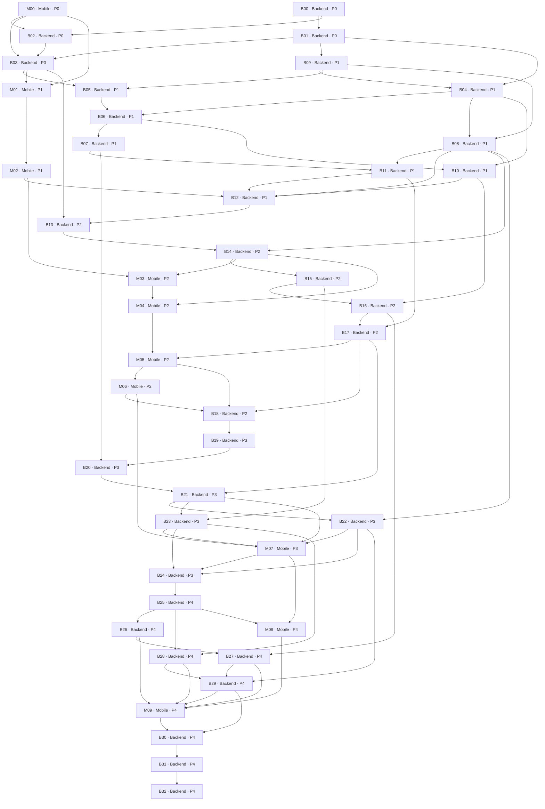

# Brain AI v2 master execution plan

Version 2.0.0-draft.1 · 2026-10-15 · Proposed. Planning complete when artifact validation passes; implementation is not authorized by creation of this draft. No workers started and no production work performed.

## Authoritative bundle and scope

Read [architecture](BRAIN_AI_V2_ARCHITECTURE.md), [requirements](BRAIN_AI_V2_PRD.md), [data model](BRAIN_AI_V2_DATA_MODEL.md), [API contract](BRAIN_AI_V2_API_CONTRACT_v2.0.0.md), [evaluation](BRAIN_AI_V2_EVALUATION.md), and [task specifications](BRAIN_AI_V2_TASK_SPECIFICATIONS.md). [Master JSON](BRAIN_AI_V2_TASKS.json) defines IDs/dependencies; [backend JSON](BRAIN_AI_V2_BACKEND_TASKS.json) and [mobile JSON](BRAIN_AI_V2_MOBILE_TASKS.json) are exact repository-specific views. Every task has exactly one target repository. Cross-repository dependencies retain global IDs and explicit handoff evidence. No application worker owns both repositories.

43 tasks: 33 backend, 10 mobile. Scope includes architecture-to-release verification across all 13 workstreams. Rough effort 239–374 engineer-days including audit/approval preparation, excluding approval/access waits and additional independent reviewer time; this is a planning range, not a calendar commitment. Phase gates support incremental value; email/activity/location remain later phases. XL tasks require worker-local decomposition/review after baseline validation rather than one giant implementation diff. Human/host unknowns prevent a reliable fixed delivery date.

## Phase plan and measurable exits

| Phase | Tasks / intended result | Exit gate |
|---|---|---|
| 0 baseline and contracts | B00/B01/B02/B03 and read-only M00; preserve existing dirty work, deployed schema/APK/host facts, isolated restore, synthetic baselines, strict contract bundle | G0 baseline/safety approval plus G1 exact API hash approval; all essential unobserved deployment facts resolved or block affected rollout. |
| 1 correctness/privacy/reliability | B09/B04/B05/B06/B07/B08/B10/B11/B12; M01/M02 after G1 | G2: Q1–Q5/Q7–Q9 passing for current flows, all correction and owner matrix cases pass, schema drift detection works; notification revision durability deliberately pending G3. No claim Phase1 fixes historical lost evidence. |
| 2 observation/canonical contracts | B13–B18, M03–M06 | G3: 10,000 persisted native observations reconcile through failures; no lost revisions, stable canonical finance ID, exact original-currency reports, correction preservation and old/new compatibility. Q1–Q10 current for enabled flows. |
| 3 semantic memory/retrieval | B19–B24, M07 | G4: measured model/index decision, Recall@20 >=0.90, ANN vs exact >=0.95 if used, no filter leaks, episode precision >=0.95, bounded model/cost targets and authorized shadow period. |
| 4 multi-source intelligence | B25–B32, M08–M09 | G5 then independent final release: cursor/revoke/attachment/receipt/signal/consent tests, zero false merges and all Q1–Q10; approved production deployment/migration decision still separate. |

Safety fixes can be released incrementally only through independent relevant gate checks and explicit production approval. Phase1 release cannot advertise full revision durability. Phase0 and contract review do not permit mobile implementation before G1. If a critical live security issue needs containment before G1, escalate a separately scoped human-approved containment action; do not bypass the approved task dependency rules.

## Workstream coverage

| Workstream | Principal backend tasks | Mobile tasks |
|---|---|---|
| WS01 projections | B04/B15/B12 | M05 correction display |
| WS02 auth/privacy | B00/B03/B05/B06/B07/B11 | M00/M02/M08 |
| WS03 durable jobs | B08/B12 | M04 delivery consumes durable API |
| WS04 migration integrity | B09/B05/B13/B32 | M03 local schema only |
| WS05 observation | B02/B13/B14/B17/B18 | M01/M03/M04/M05/M06 |
| WS06 extraction | B15/B10 | M05 fact presentation |
| WS07 finance | B10/B16/B27 | M05 original-currency UI |
| WS08 embeddings | B19/B20 | M07 consumes retrieval only |
| WS09 hybrid RAG | B21/B22/B29 | M07 |
| WS10 episodes | B23/B28/B29 | M07/M08 |
| WS11 connectors | B25/B26/B27/B28/B29 | M08/M09 |
| WS12 efficiency | B07/B22/B29 | M07 query privacy intent |
| WS13 evaluation | B01/B12/B18/B19/B24/B30/B32 | M00/M06/M09 |

## Supervisor execution protocol

Supervisor is strictly orchestration-only. It reads the approved bundle, maintains task states/dependencies, records approval hashes, creates or requests workers, reserves ownership, collects reports, delegates independent verification, coordinates integration and escalates blockers. It never writes application code, migrations or tests, repairs failures directly, runs implementation changes, or silently changes requirements. All coding, migrations, tests, verification execution and integration fixes go to workers. It may update orchestration state/approval ledger without altering approved architecture semantics.

Task states: planned -> awaiting_approval/ready -> in_progress -> awaiting_verification -> verified. Failed verification -> blocked or ready-for-worker-fix (recorded as ready with failure reason); do not call implemented work complete. Dependencies require **verified**, not merely merged. An approval task requires explicit human evidence. Production authorization is not implied by G5 or this plan.

Before dispatch: confirm exact target repo and approved baseline snapshot. User dirty state exists in both repositories; do not assume a new HEAD-based worktree contains it. A designated baseline/integration worker creates a reviewed snapshot including needed uncommitted changes, records hash and preserves excluded sensitive/ignored state safely. Do not automatically commit all untracked files, especially env/signing material. Prefer supported isolated worktrees; otherwise reserve an entire repo checkout exclusively. No assumption that Orca supports cross-repo spawning or shared worker ownership. Backend Supervisor hands the mobile manifest/approved contract hash to a human or separately attached mobile coordinator through a supported, explicitly authorized channel; lack of that channel is a dependency blocker, not permission to open a mobile coding worker from backend.

Every worker prompt includes task ID, target repository, approved input revisions/contract hash, exclusive paths, forbidden other repo, dependencies, specification links, test environments, acceptance, expected report location, approval restrictions and rollback. Backend workers cannot edit mobile, including copying contract bytes into mobile. Mobile workers cannot edit backend, including contract fixes. Requests for contract changes go to backend contract worker; reapproval and separate consumer import precede mobile dependent work.

Verifier must be different from implementation worker for all safety/integration gates and whenever practical for feature tasks. It uses a fresh repository-local worktree and approved isolated test environment, not the implementer's claimed passing log alone. Test or integration failures return to a specialized worker; Supervisor delegates, then independent verifier repeats affected checks at integrated hash. Final release verifier B32 repeats gates after B31 integration fixes. M09 explicitly separates integrator and verifier identities. No self-certified release.

## Parallel execution and file ownership

DAG readiness is necessary but insufficient. Manifest exclusive_write_paths are conservative reservations; wildcard directories overlap contained paths. Never run overlapping writes concurrently simply because worktrees differ. Integration worker owns conflict resolution in its repository. Schema specialist exclusively reserves migrations/expected-object manifest/runner during each schema window; feature workers provide reviewed schema requests. Shared `package.json` changes also require serialization. Reserve graphify output once per integrated repository update, as graph updates can conflict.

Safe opportunities after prerequisites, with named reservations:

- B00 backend read-only baseline and M00 mobile read-only baseline may proceed in separate authorized sessions; no cross-repo writes. B01 evaluation corpus and B02 contract schema can proceed concurrently after their prerequisites if package.json registration is serialized by B01, then B02 rebases its script addition.
- B09 and B02 are independent after baseline, but B09/B01 package.json changes serialize. Contract review need not wait for safety-fix implementation.
- After B06, B07 provider/privacy and B10 money/finance can run concurrently: their declared paths are disjoint; any discovered shared callsite pauses the second worker until a reviewed handoff.
- After M02 and API readiness, mobile native capture work can proceed alongside backend facts/finance. Neither worker edits the other's repository. B12/G3 dependencies still require reports before promotion.
- After B21, B22 provider/model efficiency and B23 new episode modules can run concurrently only if B23 owns job-worker/episode files and does not edit B22 shared callers. New shared integration glue is delegated after both branches land.
- After B25, B26 Gmail and B28 signals can run concurrently; both use connector files but individual file reservations are disjoint. Any shared connector registry edit is owned by B25/integration worker. M08 can build approved consent adapters against contract fixtures without assuming live Gmail readiness.
- M09 and backend verification exchange reports. Integration changes require the matching repository worker; no dual-repo fixer.

Do not parallelize B04/B08/event-store, B06 broad authorization with feature repository edits, B07/B11 embedding/privacy/intelligence, B15/B16 event-store, or B20/B23 job-worker when reservations overlap. The task DAG already sequences most of these; remaining overlaps use ownership reservations, not optimistic merging. If a reservation changes, Supervisor records amended boundaries before dispatch.

## Cross-repository milestones and compatibility matrix

| Milestone | Producer -> consumer | Required immutable handoff | Gate behavior |
|---|---|---|---|
| C0 baseline | M00 -> B02/B03 | Mobile static/native uncertainty report and contract feasibility | Contract review cannot assume a tested APK from source alone. |
| C1 API approved | B02/B03 -> M01 and all mobile implementation | API schema/examples hash, approval ledger, auth/retention/limits decisions | No mobile coding until explicit human G1. |
| C2 privacy safety | M02 -> B12 | Native credential/consent/signing report | G2 blocked without mobile evidence; no claim backend fixed signing. |
| C3 capture ready | B14 -> M03/M04 | Backend conformance + deployed test service/capabilities/contract hash | Mobile may use mocks earlier only after G1; runtime gate requires real test service. |
| C4 canonical DTO ready | B17 -> M05 | Decimal/correction/evidence DTO fixture and provider policy report | Mobile uses original currencies, no hidden app conversion. |
| C5 native durable | M05/M06 -> B18 | APK hash, queue receipts/counts and physical-device report | G3 rejects missing native durability evidence. |
| C6 retrieval/episode | B21/B22/B23 -> M07 -> B24 | Approved query schema and any newly approved episode schema, benchmark, mobile QA report | New wire shape requires reviewed version/reapproval before dependent UI. |
| C7 multi-source | B25–B29 <-> M08/M09 -> B30 | OAuth/connector fixtures, source consent and battery/revoke tests | Connector distribution permissions and G5 human policy choice required. |
| C8 release | B31/B32 plus M09 | Final exact repo/APK/DB/API hashes, restore/rollback/Q1–Q10 evidence | Production/destructive action remains separately blocked pending explicit human approval. |

Compatibility matrix at G3 and release: old v1 app/current backend; old v1 app/v2-compatible backend; new v2 app/v2 backend; new v2 app/old backend. The last case must hold v2 queued revisions and show unsupported capability, not silently downgrade updates to v1 key-only capture. Also test backend rolling deployments with old workers paused from incompatible stage publication, and mobile upgrade/rollback with pending encrypted queue rows. Keep contract artifact hashes in every report.

## Deployment and rollback gates

Before any production action: independent current test evidence, required schema objects and restricted roles verified, restore drill and tombstone reconciliation, feature flags/canary owner selection, queue capacity and host cron/timeout validation, secrets/signing review, mobile distribution plan, forward/backward writer compatibility. Propose deployment order: additive schema -> compatible backend under disabled flags -> independent staging conformance -> compatible mobile build -> per-owner shadow/canary -> enable reads/publication -> monitor -> approved legacy cleanup much later. Destructive removal is never a necessary early step.

Hard failures trigger rollback flag/pause, not deletion: any lost financial evidence, wrong-owner response, forbidden provider payload, unknown-currency total, stale-fence side effect, dropped revision, false merge, lost correction, retrieval leak or unapproved destruction. Alert on expired lease >two polls, backlog >5min, capture pending growth/storage pressure, provider budget/timeouts and reconciliation divergence; metadata only, no personal payload. Rollback worker preserves evidence/new writes and checks compatibility before old code runs. Restore-to-old-snapshot is disaster recovery requiring explicit human coordination.

## Human decisions and bounded recommendations

Approve proposed device-to-owner credential registry for first release; defer OAuth user enrollment until needed. Approve legacy ownership mapping/quarantine, contract limits and retention defaults at G1; do not guess ownership of null/global entities. Security owner decides signing remediation after private provenance assessment; key rotation/history rewrite needs explicit approval and upgrade/distribution plan. G4 selects measured embedding provider/index and budget; default to current hash+FTS until a learned model meets quality/privacy/host limits. Gmail first with bounded sync; location/activity remain off until permission/battery and retention gates pass. Production/destructive actions always require separate approval. If deployed DB/APK facts cannot be read, finish source planning but leave G0/release blocked with the exact missing access and evidence.

## Supervisor Handoff Checklist

- [x] Current source inspected and audit hypotheses classified with evidence/uncertainty.
- [x] Backend/mobile ownership, separate manifests and explicit external dependencies defined.
- [x] Contracts, data model, migration strategy, regression datasets and measurable gates specified.
- [x] Supervisor code/test/migration work prohibited; independent workers own implementation and verification.
- [x] No cross-repo spawning assumption; mobile can be handed to a separately attached coordinator.
- [x] Plan JSON and DAG validation required before delivery.
- [ ] G0 deployment/restore facts and safe baseline approved by future investigator/human.
- [ ] G1 concrete schema bundle/hashes approved before mobile implementation.
- [ ] Implementation, independent gates, deployment/destructive approvals remain future work.

The bundle is ready for review and delegated execution after its prerequisite approvals; no feature or phase is declared implemented.

## Complete task DAG (validated)

Every node below is one repository-owned task. B = BrainIA-Backend; M = BrainIA-Mobile. Edges require verified dependency evidence. Approval and path reservations still apply.

Longest chain by task count (30 tasks): `B00 -> B01 -> B09 -> B05 -> B06 -> B07 -> B11 -> B12 -> B13 -> B14 -> B15 -> B16 -> B17 -> M05 -> M06 -> B18 -> B19 -> B20 -> B21 -> B23 -> M07 -> B24 -> B25 -> B26 -> B27 -> B29 -> M09 -> B30 -> B31 -> B32`. It is a sequencing constraint, not a date forecast. Longest chain by midpoint effort estimate: `B00 -> B01 -> B09 -> B05 -> B06 -> B07 -> B11 -> B12 -> B13 -> B14 -> B15 -> B16 -> B17 -> M05 -> M06 -> B18 -> B19 -> B20 -> B21 -> B23 -> M07 -> B24 -> B25 -> B26 -> B27 -> B29 -> M09 -> B30 -> B31 -> B32` (218.0 engineer-days before approvals/review waits). File reservations can lengthen this further.

| Task | Repository | Phase | Dependencies | Objective |
|---|---|---|---|---|
| B00 | BrainIA-Backend | 0 | none | Deployment, schema, dirty-state and recovery baseline |
| M00 | BrainIA-Mobile | 0 | none | Read-only mobile capture and signing feasibility audit |
| B01 | BrainIA-Backend | 0 | B00 | Golden corpus and offline evaluation harness |
| B02 | BrainIA-Backend | 0 | B00, M00 | Publish strict shared API schemas and fixture bundle |
| B03 | BrainIA-Backend | 0 | B02, B01, M00 | Record explicit human API approval G1 |
| B09 | BrainIA-Backend | 1 | B01 | Verify schema objects and replace runtime table-sentinel repair |
| B04 | BrainIA-Backend | 1 | B01, B09 | Separate projection cleanup and preserve financial/correction identity |
| B05 | BrainIA-Backend | 1 | B09, B03 | Add owner schema and quarantine legacy personal identities |
| M01 | BrainIA-Mobile | 1 | B03, M00 | Import approved contract and mobile conformance validation |
| B06 | BrainIA-Backend | 1 | B05, B04 | Principal-bound authorization across all APIs and repository queries |
| B08 | BrainIA-Backend | 1 | B04, B09 | Leased fenced SQL jobs and bounded workers |
| M02 | BrainIA-Mobile | 1 | M01 | Secure native credentials and explicit capture consent |
| B07 | BrainIA-Backend | 1 | B06 | Provider/source privacy at every external model boundary |
| B10 | BrainIA-Backend | 1 | B06, B04 | Currency ambiguity and current financial evidence safety |
| B11 | BrainIA-Backend | 1 | B07, B08 | Deletion/retention across raw and derived knowledge |
| B12 | BrainIA-Backend | 1 | B10, B11, B08, M02 | Independent Phase1 gate G2 |
| B13 | BrainIA-Backend | 2 | B12, B03 | Observation/revision storage and safe legacy backfill |
| B14 | BrainIA-Backend | 2 | B13, B08 | Capture v2 and compatible v1 adapters |
| B15 | BrainIA-Backend | 2 | B14 | Typed fact validation and persistent correction overlays |
| M03 | BrainIA-Mobile | 2 | M02, B14 | Encrypted durable Android outbox |
| B16 | BrainIA-Backend | 2 | B15, B10 | Canonical financial matching and lifecycle extension |
| M04 | BrainIA-Mobile | 2 | M03, B14 | Revision identity and single WorkManager delivery pipeline |
| B17 | BrainIA-Backend | 2 | B16, B11 | Canonical evidence, corrections and exact finance DTOs |
| M05 | BrainIA-Mobile | 2 | M04, B17 | Capture state, provenance, corrections and exact-money UI |
| M06 | BrainIA-Mobile | 2 | M05 | Independent native capture and contract certification |
| B18 | BrainIA-Backend | 2 | B17, M06, M05 | Independent observation milestone G3 |
| B19 | BrainIA-Backend | 3 | B18 | Measured learned embedding and indexing decision |
| B20 | BrainIA-Backend | 3 | B19, B07 | Isolated incremental embedding lifecycle |
| B21 | BrainIA-Backend | 3 | B20, B17 | Uniform hybrid retrieval and complete eligible corpus recall |
| B22 | BrainIA-Backend | 3 | B21, B08 | Bounded LLM routing, caching and scoped publication |
| B23 | BrainIA-Backend | 3 | B21, B15 | Revisioned asynchronous episodes and temporal reasoning |
| M07 | BrainIA-Mobile | 3 | M06, B21, B23, B22 | Grounded retrieval and episodic UI |
| B24 | BrainIA-Backend | 3 | B22, B23, M07 | Independent semantic/temporal milestone G4 |
| B25 | BrainIA-Backend | 4 | B24 | Reusable connector lifecycle and secure cursor storage |
| B26 | BrainIA-Backend | 4 | B25 | Least-privilege Gmail synchronization |
| B28 | BrainIA-Backend | 4 | B25, B23 | Activity/location normalization with explicit uncertainty |
| M08 | BrainIA-Mobile | 4 | B25, M07 | Granular email/activity/location consent and adapters |
| B27 | BrainIA-Backend | 4 | B26, B16 | Receipt/notification correlation without duplicate totals |
| B29 | BrainIA-Backend | 4 | B27, B28, B22 | Extend grounded proactive cross-source intelligence |
| M09 | BrainIA-Mobile | 4 | M08, B26, B27, B28, B29 | Mobile integration and independent final certification |
| B30 | BrainIA-Backend | 4 | B29, M09 | Independent multi-source milestone G5 |
| B31 | BrainIA-Backend | 4 | B30 | Delegate final backend integration fixes |
| B32 | BrainIA-Backend | 4 | B31 | Final independent release evidence and deployment decision |
